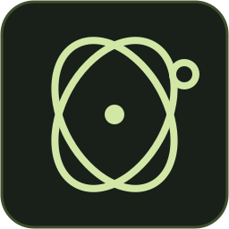

<p align="center">
  
</p>

<h1 align="center">openHiatus</h1>

<p align="center">
  <strong>A helping hand for your Windows PC.</strong><br>
  Talk to it. Let it work. Or ask it to show you how.
</p>

<p align="center">
  
  
  <a href="LICENSE"></a>
</p>

<p align="center">
  <a href="#getting-started">Get started</a> ·
  <a href="docs/user-guide.md">User guide</a> ·
  <a href="#development">Contribute</a> ·
  <a href="docs/vision.md">Vision</a> ·
  <a href="https://github.com/openhiatus/openhiatus/issues">Issues</a>
</p>

openHiatus is an open-source desktop assistant that helps you use the programs already on your computer. Ask by voice or text: it can point out where to click, work with files, or carry out a task while you keep the conversation going. You choose the AI models and accounts it uses.

## What you can do

- 🎯 **Ask it to show you.** A circle and arrow highlight the next click on your screen. You stay in control.
- 🖥️ **Ask it to do the work.** Operate Windows apps, work with files and follow task progress and results. Up to two background tasks can run while you chat.
- 🎙️ **Talk or type.** Use push-to-talk, hear spoken replies, or stay with text. Voice is optional.
- 🧠 **Make it yours.** Choose your assistant's name and style, edit its memory and keep a history of your work.
- 🔌 **Choose your models.** Sign in with ChatGPT, connect Anthropic, Google, OpenRouter or OpenAI, or use a local OpenAI-compatible server.

Try asking:

> “Show me where to open my browser.”<br>
> “Where is the bold button in this program?”<br>
> “Create a text file with these notes in my workspace.”

## Getting started

**Early public alpha:** expect bugs and changes. Public release downloads are not available yet; run from source below. You can also [build a Windows installer](docs/windows-installation.md#setup-bauen), which is currently unsigned.

### Development requirements

Windows 10 (2004 or newer) or Windows 11, **x64**, plus **Node.js 24**, npm and Git. The build uses Windows PowerShell and the .NET Framework 4 C# compiler. [Full requirements →](docs/development.md#development-requirements)

```powershell
git clone https://github.com/openhiatus/openhiatus.git
cd openhiatus
npm ci
npm start
```

`npm start` builds the app and opens it. The packaged app includes its runtime; its users do not need Node.js, Git or a separate agent installation.

### First-time setup

1. **Choose your language** and review the access notice. Give your assistant a name if you like.
2. **Connect a model account** or local server. Start with text, or add an Inworld account for voice.
3. **Test your first reply**, then ask for help with something on your screen.

The interface supports English, Spanish, French, German, Simplified Chinese, Japanese and Brazilian Portuguese. Model and speech services use your own accounts and may incur charges. [Setup details →](docs/user-guide.md#first-time-setup)

| Shortcut | Action |
| --- | --- |
| **F8** | Start or stop recording |
| **F9** | Send a reviewed transcript |
| **Ctrl+Enter** | Send a typed message |
| **Ctrl+Alt+F12** | Stop managed work globally |
| **Esc** | Stop in the app, or from any program during desktop takeover |

## Privacy and safety

openHiatus runs with **your Windows permissions, without a sandbox**. It can change files and operate applications. Review important results; approval before critical actions is still planned.

- **Desktop control is visible.** An amber frame and banner appear while the agent owns the desktop. Ordinary mouse and keyboard input is blocked during takeover; **Esc** stops it and returns control. Screen guidance leaves you in control.
- **Stop ends further managed actions; it does not undo changes.** Independently handed-off work windows can remain open.
- **Your profile stays on your PC.** Settings, history and memory live in `%APPDATA%\openhiatus`; credentials use Windows-protected storage. Cloud models and speech services receive the data needed for their tasks.

Desktop interaction currently supports the **primary display only** and uses screenshots. Live audio and multi-monitor control are not available yet. [More about controls, data and limitations →](docs/user-guide.md#privacy-and-safety)

## Documentation

| I want to… | Start here |
| --- | --- |
| Set up models, Fast, voice or everyday controls | [User guide](docs/user-guide.md) |
| Install, update or remove the Windows app | [Windows installation](docs/windows-installation.md) |
| Get help directly on my screen | [Screen help](docs/screen-help.md) |
| Change the assistant's personality or memory | [Identity and memory](docs/identity-and-memory-files.md) |
| Connect my calendar | [Google Calendar](docs/google-calendar.md) — requires your own Google OAuth client |
| Explore computer-use experiments | [Image budgets](docs/computer-use-image-budget.md) · [Separate computer model](docs/computer-use-computermodell.md) |
| Understand the code or run checks | [Development guide](docs/development.md) · [Architecture](docs/architekturpruefung.md) |

Some detailed guides are currently in German.

## Development

Built with **Electron, React and TypeScript**, using [Pi](https://www.npmjs.com/package/@earendil-works/pi-coding-agent) as the agent runtime.

After making code changes, run:

```powershell
npm run check
npm run build
```

The [development guide](docs/development.md) covers the relevant UI checks, isolated test profiles, packaging and benchmarks. Documentation changes only need UTF-8, link and consistency checks.

### Contributing

Bug reports, small fixes, documentation improvements and feedback from everyday use are welcome. [Open an issue](https://github.com/openhiatus/openhiatus/issues) or send a pull request. Use synthetic examples and keep personal profiles, credentials and private data out of submissions.

## Direction

We're building toward reliable, affordable help on your own PC: better understanding of interfaces, clearer handover between you and the agent, and workflows you can reuse. See the [vision](docs/vision.md) and [roadmap](docs/roadmap.md) for what's next.

## License

[MIT](LICENSE). Dependencies and bundled components keep their own licenses.
