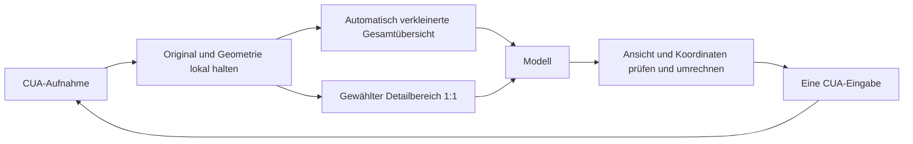

# Computer Use: variable Übersichtsskalierung und Detail 1:1

Stand: 22. Oktober 2026. Die erste experimentelle Umsetzung liegt auf Basis von openHiatus 0.1.6 vor. Der Vollbildweg bleibt Standard. Die folgenden Forschungs- und Abnahmeziele sind damit noch nicht vollständig erledigt.

## Umgesetzter Stand und offene Abnahme

- Die Einstellung `computerOverviewScaleDivisor` bietet 1:1, 1:4, 1:8, 1:16 und 1:32. Endliche Faktoren von 1 bis 64 sind im Datenvertrag zulässig. Die Auswahl wird beim nächsten Erwerb der Desktopsteuerung übernommen und bleibt während dieser Arbeitsphase unverändert.
- `computer-views.ts` rechnet Punkte und Rechtecke anhand der tatsächlichen Bildgrößen um. `computer-images.ts` erzeugt Übersicht und Originalausschnitt mit Electrons `nativeImage`, explizit bei Bildskalierung 1. `computer-regions.ts` wählt einen Bereich aus Originalpixel-Differenzen, bisherigem Ausschnitt, Aktionspunkt und optionalem Modellhinweis.
- `computer-observations.ts` hält die aktuelle Originalaufnahme und ihre Ansichten. `computer-input.ts` definiert den Werkzeugvertrag. `computer.ts` prüft Lebensdauer und Treibergeometrie, übersetzt eine Aktion und behält die bestehende Darstellungswartezeit sowie Stop-Logik bei.
- Metadaten V2, `inspect`, `nextDetail`, Drag zwischen Ansichten, Originalauflösung des lokalen Details und eine Vorschau derselben Modellbilder sind angeschlossen. Faktor 1 verwendet weiterhin den Vollbildvertrag V1 ohne Bildaufbereitung. Ein Detail darf höchstens 1.048.576 Originalpixel umfassen; übergroße Anforderungen werden abgelehnt.
- Bei fehlender Orientierung kann das Modell ausdrücklich `{"action":"screenshot","resolution":"original"}` aufrufen. Diese Antwort enthält genau ein frisches, vollständiges Originalbild des Hauptmonitors und neue Bildkennungen. Die nächste gewöhnliche Aufnahme oder Aktionsantwort verwendet wieder den gespeicherten Faktor. Im Übersichtsmodus bleibt auch die volle Ansicht im V2-Koordinatenvertrag mit Faktor 1; im bisherigen Vollbildmodus bleibt V1 erhalten. Die Größenbegrenzung für Details gilt weiter für Ausschnittanforderungen. Auch das ausdrücklich angeforderte Vollbild erhält beim unterstützten OpenAI-Adapter die Original-Bilddetailstufe.
- Der OpenAI-Responses-Hook setzt `detail: original` nur für markierte Bilder der zugehörigen Computer-Werkzeugantwort und ausdrücklich unterstützte Modelle. Fremde Bilder, andere Anbieter und unbekannte Modelle behalten ihr bisheriges Verhalten. Anbietergrenzen können dennoch zu einer internen Verkleinerung führen. [OpenAI: Computer-use integration](https://developers.openai.com/api/docs/guides/tools-computer-use-integration)
- Geometrie, Auswahl, Lebensdauer, Transport und Vorschau sind synthetisch geprüft. Echte Windows-Zielklicks bei verschiedenen DPI, allgemeine Programmaufgaben, Paketabnahme und wiederholte Vergleiche aus Gesamtdauer, Tokenverbrauch und Erfolgsquote bleiben offen. Die Skalierungsflags der Bildtests simulieren unterschiedliche Electron-Skalierungen; sie ersetzen keine Windows-DPI-Abnahme.

Die Bildaufbereitung und der begrenzte Pixelvergleich laufen in dieser ersten Version synchron im Main-Prozess. Ihre getrennten lokalen Zeiten stehen in den Metadaten. Eine Auslagerung hinter dem Bild-Port bleibt möglich, falls Messungen relevante UI-Blockaden zeigen. Es gibt noch keine gemessene Beschleunigungszusage und keinen neuen Auslieferungsstandard.

## Ziel und Grundentscheidung

openHiatus erhält pro Bildschirmbeobachtung eine verkleinerte Übersicht des gesamten unterstützten Bildschirms und den gerade relevanten Bereich in Originalauflösung. Die Übersicht wird durch einen variablen Faktor direkt aus der nativen Aufnahme berechnet. Vorbereitet werden insbesondere die Versuchsprofile 1:4, 1:8, 1:16 und 1:32. Ein Detail ist ein echter Ausschnitt aus dem Original, kein vergrößerter Teil der Übersicht.

Die native Bildschirmgröße wird aus der tatsächlichen Aufnahme und der überprüften Treibergeometrie ermittelt. 4K ist ein Rechenbeispiel und keine Voraussetzung. openHiatus verwendet die vorhandene native Aufnahme als Basis und skaliert sie nicht künstlich hoch. Auch die Details bleiben Ausschnitte dieser nativen Auflösung. Nutzer müssen ihre Auflösung nicht eintragen. Für die spätere Auslieferung gibt es einen gemeinsamen Standard; die Auswahl eines Versuchsprofils ist eine optionale Entwicklungsfunktion und keine Voraussetzung für andere Rechner.

| Verkleinerung | Full HD: 1920 × 1080 | UHD: 3840 × 2160 |
| --- | --- | --- |
| 1:4 | 480 × 270 | 960 × 540 |
| 1:8 | 240 × 135 | 480 × 270 |
| 1:16 | 120 × 68 | 240 × 135 |
| 1:32 | 60 × 34 | 120 × 68 |

Die Berechnung lautet; halbe Pixel werden auf ganze Pixel gerundet:

```text
overviewWidth  = max(1, round(originalWidth  / overviewScaleDivisor))
overviewHeight = max(1, round(originalHeight / overviewScaleDivisor))
```

`overviewScaleDivisor` ist eine endliche Zahl ab 1. So bleiben Seitenverhältnis und Ausrichtung bis auf die unvermeidbare Rundung auf ganze Pixel erhalten. Dieselbe Regel funktioniert für Ultrawide, Hochformat und andere Auflösungen. Kleine synthetische Bilder können bis auf mindestens 1 × 1 Pixel schrumpfen und werden nie vergrößert. Die Koordinatenschicht verwendet die tatsächlichen Bildabmessungen pro Achse; durch Rundung kann das effektive Verhältnis geringfügig vom angeforderten Faktor abweichen.

Die bisher diskutierte Normierung aller Auflösungen auf dieselbe längere Bildseite ist eine andere Strategie mit ähnlichem Übersichtsbildbudget. Sie ist kein beschlossener Standard und bleibt höchstens ein zusätzlicher Vergleichsfall. Hauptgegenstand sind die echten Verkleinerungsfaktoren. 1:8 dient nur als Ausgangsprofil für den Versuch; wie weit die Übersicht sinnvoll verkleinert werden kann, entscheidet der Vergleich aus Zeit, Erfolgsquote und zusätzlichen Beobachtungsrunden.

### Vorzusehende Variablen

Die folgenden Namen beschreiben die Versuchsachsen. Implementiert ist die Übersichtsskalierung als gespeicherte Einstellung `computerOverviewScaleDivisor`; Detail- und Analyseauflösung bleiben fest bei 1, das Encoding bei PNG. Diese drei Werte sind noch keine frei änderbaren Laufzeitparameter:

```json
{
  "overviewScaleDivisor": 8,
  "detailScaleDivisor": 1,
  "changeAnalysisScaleDivisor": 1,
  "overviewEncoding": "png"
}
```

- `overviewScaleDivisor`: unabhängig wählbarer Versuchsparameter; der Vergleich enthält 4, 8, 16 und 32. Faktor 1 kann als bisheriger Vollbild-Vergleich dienen.
- `detailScaleDivisor`: bleibt in diesem Vorhaben 1. Eine kleinere Übersicht reduziert nicht die Auflösung des Originalausschnitts.
- `changeAnalysisScaleDivisor`: eigener Parameter für die lokale Änderungserkennung. Eine Übersicht 1:32 darf den lokalen Detektor nicht ebenfalls auf 1:32 zwingen; sonst könnten wichtige kleine Änderungen bereits vor der Bereichsauswahl verschwinden.
- `overviewEncoding`: zunächst verlustfreies PNG. Dateikompression und Auflösungsreduktion werden getrennt behandelt. Falls weitere Encodings untersucht werden, sind Format und Qualität eigene Parameter; sie werden nicht gleichzeitig unbemerkt mit dem Faktor verändert.

Jeder Messlauf erhält eine Profilkennung und protokolliert Parameter sowie tatsächliche Bildmaße. Ein Profilwechsel erzeugt neue Ansichten; Eingaben verwenden niemals einen global angenommenen Faktor aus der aktuellen Konfiguration für ein älteres Bild. Endnutzer brauchen weiterhin keinen persönlichen Bildschirmfaktor, weil derselbe Auslieferungsstandard auf die automatisch erkannte native Aufnahme angewandt wird.

Die Funktion arbeitet mit Bildern, Rechtecken und Koordinaten. Wie der relevante Bereich am schnellsten gewählt wird, ist eine offene Forschungs- und Messfrage. Vorrang hat die gesamte Zeit bis zum erfolgreichen Ergebnis; kleinere Bild- oder Tokenmengen sind dafür nur Hilfsmittel. Der erste zu untersuchende Ansatz ist eine lokale, deterministische Änderungserkennung nach Aktionen, kombiniert mit dem bisherigen Bereich und vorhandenen Aktionsdaten. Eine ausdrückliche Modellwahl bleibt Vergleichsverfahren und Rückfallmöglichkeit.

Browser, Dateiverwaltung, Texteditor, Terminal, Tabellenkalkulation und andere Windows-Programme verwenden denselben Ablauf. Programmnamen, Zelladressen, DOM-Selektoren und anwendungsspezifische Bedienregeln gehören nicht in diese Schicht.

Die erste Umsetzung verwendet den bereits unterstützten Hauptbildschirm. Die Metadaten enthalten eine Bildschirmkennung, damit eine spätere Erweiterung auf weitere Monitore denselben Vertrag verwenden kann. Mehrmonitor-Unterstützung ist eine eigene Erweiterung; sie wird durch diesen Umbau nicht behauptet.

## Geprüfter Ausgangspunkt

- [computer.ts](../src/main/computer.ts) übernimmt Aufnahme, Einzelaktionen, aktuelle Bildkennungen, Geometrieprüfung, Abbruch und den Zugriff auf den CUA-Treiber. Bisher stimmen Bild- und Bildschirmabmessungen überein.
- Nach einer Eingabe prüft openHiatus mehrere Aufnahmen innerhalb einer begrenzten Darstellungswartezeit. Nur die letzte freigegebene Aufnahme wird an das Modell zurückgegeben.
- Der heutige SHA256-Vergleich erkennt Unterschiede kompletter PNG-Dateien, aber keine Position oder Größe einer Änderung. Räumlicher Pixelvergleich und ein Bereichszustand müssen ergänzt werden. Die aktuelle Aktion und ihre Koordinaten sind im Aufruf bereits verfügbar. Der CUA-SDK bietet eine Cursorabfrage, die openHiatus bisher nicht anbindet; Cursor und Tastaturfokus sind unterschiedliche Signale.
- [pi.ts](../src/main/pi.ts) verschickt bisher genau dieses vollständige PNG als Werkzeugbild.
- [agent-host.ts](../src/main/agent-host.ts) und [contracts.ts](../src/shared/contracts.ts) können mehrere Bildinhalte transportieren. Eine ausdrückliche Zuordnung der Ansichten und ihrer Koordinaten fehlt bisher.
- Die installierte Pi-Version 1.3.0 setzt im Responses-Adapter für Bilder `detail: auto`. Ihr Bildtyp hat kein eigenes Detail-Feld; ein bloß zusätzliches openHiatus-Feld würde beim Übersetzen zum Anbieter verloren gehen. Ein dokumentierter `onPayload`-Rückruf ist vorhanden.
- [ComputerPreview.tsx](../src/renderer/ComputerPreview.tsx) zeigt bisher ein einzelnes Bild und beschreibt es als das vom Modell ausgewertete Bild.

## Ablauf für beliebige Anwendungen

1. `screenshot` erstellt eine aktuelle Originalaufnahme. openHiatus prüft die aktuelle Geometrie, behält das Original lokal und erzeugt daraus die Übersicht mit dem gewählten Versuchs- beziehungsweise Standardfaktor.
2. Ein lokaler Selektor erzeugt einen Vorschlag für den Detailbereich. Nach Aktionen kann er die Änderung zur letzten dem Modell gezeigten Aufnahme, den bisherigen Bereich, den Aktionspunkt und einen optionalen Modellhinweis aus dem vorherigen Schritt verwenden. Übersicht und ausgewähltes Detail werden gemeinsam zur nächsten regulären Modellrunde geschickt. Fehlt ein brauchbarer Vorschlag, reicht zunächst die Übersicht.
3. Fehlt im gelieferten Detail das benötigte Ziel oder dessen lesbarer Kontext, wählt das Modell mit `inspect` ein anderes Rechteck. openHiatus übersetzt dieses Rechteck und schneidet das Detail aus der gespeicherten Originalaufnahme. Dieser Aufruf führt keine Eingabe aus und benötigt keine zusätzliche Bildschirmaufnahme; die anschließende Modellrunde kostet trotzdem Zeit.
4. Eingaben nennen die aktuelle Aufnahme und die Ansicht, auf deren Koordinaten sie sich beziehen. openHiatus berechnet daraus die Bildschirmkoordinaten und führt genau eine native Aktion aus.
5. Nach der Aktion liefert openHiatus eine neue Übersicht und den vom Selektor beibehaltenen oder neu vorgeschlagenen Detailbereich aus der neuen Aufnahme. Ein Bereichswechsel wird mit eigener Ansichtskennung und Quellrechteck kenntlich gemacht.

Ein sinnvoll vorhergesagter Bereich vermeidet die zusätzliche Auswahlrunde. Das Modell kann mit seiner ohnehin ausgegebenen Aktion optional bereits den gewünschten Detailbereich für das folgende Bild nennen. Das erfordert keinen separaten Request, kann aber zusätzliche Ausgabe- und Denkzeit kosten. Bei einem unbrauchbaren Vorschlag bleibt `inspect` erforderlich; diese Korrekturkosten gehören vollständig in die Messung.

Eine neue Übersicht zeigt weiterhin Dialoge und Veränderungen außerhalb des Details. Die Metadaten nennen das tatsächlich gewählte Rechteck und den Auswahlgrund, beispielsweise `retained`, `model-hint` oder `visual-change`. Ein Änderungsvorschlag beweist weder Aufgabenrelevanz noch Erfolg. Das Modell muss das Ziel im gelieferten Bild weiterhin prüfen, bevor es eine Eingabe ausführt.



## Lokale Änderungserkennung und Auswahlforschung

### Erster Versuchsansatz: Änderung nach einer Aktion

Die lokale Prüfung beantwortet zunächst eine engere, überprüfbare Frage: **Wo unterscheiden sich die beiden sichtbaren Zustände?** Sie benötigt dafür weder ein LLM noch eine neue Cloudanfrage. Ob die Änderung das gewünschte Ergebnis darstellt oder wohin die nächste Aktion gehen soll, entscheidet weiterhin die eigentliche Arbeitsausführung.

Der deterministische Ablauf:

1. Die letzte dem Modell gezeigte Originalaufnahme und die neue freigegebene Aufnahme als Pixelbilder vergleichen. Unterschiedliche Bildschirmgeometrien setzen die Vergleichsbasis zurück.
2. Pro Pixel einen Farbunterschied bestimmen und mit einer festgelegten Toleranz gegen Rauschen vergleichen. Der interne Vergleich verwendet Originalpixel oder eine feinere Analyseauflösung als die Modellübersicht, damit kleine Änderungen nicht schon beim Verkleinern verschwinden. Analyseauflösung, Kontextsaum und räumliche Gewichtung werden aus der aktuellen Geometrie abgeleitet; persönliche Bildschirmkoordinaten sind keine Konfiguration.
3. Geänderte Pixel intern in kleine Analysezellen und zusammenhängende Bereiche gruppieren. Diese Zellen dienen ausschließlich der lokalen Berechnung; sie werden nicht als Bildkacheln verschickt.
4. Nahe Änderungsbereiche zusammenfassen und einen Kontextsaum ergänzen, damit beispielsweise ein verändertes Feld zusammen mit seiner Beschriftung lesbar ist. Das Detail stammt weiterhin direkt aus der neuen Originalaufnahme.
5. Kandidaten anhand einer dokumentierten Kombination aus Änderung, letztem Aktionspunkt, bisherigem Detail und optionalem `nextDetail`-Hinweis ordnen. Entfernte neue Bereiche bleiben Kandidaten: Ein Dialog muss nicht neben dem ausgelösten Klick erscheinen. Gleichstände werden nach einer festen Regel aufgelöst.
6. Den gewählten Bereich zusammen mit der kleinen Übersicht in der ohnehin nötigen Werkzeugantwort liefern. Auswahlgrund, Rechteck und lokale Berechnungszeit werden als Metadaten erfasst. Aus einem Rangwert wird ohne Kalibrierung keine behauptete Trefferwahrscheinlichkeit.

Blinkender Cursor, Caret, Animationen und Statusanzeigen können Änderungen verursachen. Die Versuche prüfen räumliche und zeitliche Filter sowie eine Hysterese gegen unnötige Bereichswechsel. Kleine Veränderungen werden nicht pauschal verworfen: Ein Häkchen oder ein einzelnes Zeichen kann das relevante Ergebnis sein. Soweit zeitliche Information aus der bestehenden Darstellungswartezeit nutzbar ist, wird sie ohne zusätzliche Modellrunde verwendet; zusätzliche Aufnahmen müssten einen gemessenen Nutzen haben.

Bei Scrollen, Fensterbewegungen oder einem vollständigen Seitenwechsel kann fast die ganze Fläche verändert sein. Dann hat der reine Änderungsumfang wenig Auswahlwert. Der Selektor kann den bisherigen Arbeitsbereich oder einen Modellhinweis bevorzugen beziehungsweise als unsicher kennzeichnen und `inspect` zulassen. Bei unverändertem Bild darf er den bisherigen Bereich erneut aus der aktuellen Aufnahme liefern. Keine dieser Entscheidungen bestätigt, dass die Anwendung den Auftrag angenommen hat.

Für die erste Aufnahme ohne Vergleichsbild kann der Differenzansatz keinen Bereich bestimmen. Hier werden die Bereichswiederverwendung, ein vorhandener Hinweis und die ausdrückliche Auswahl aus der Übersicht gegeneinander geprüft. Eine zuverlässige aufgabenabhängige Erstwahl ohne weitere Information wird nicht vorausgesetzt.

### Vorhandene Technik und Forschungsgrenzen

Windows kann über die Desktop Duplication API bereits geänderte und verschobene Bildschirmrechtecke liefern. Solche Bereiche können vom Betriebssystem auch zusammengefasst und deshalb größer als die tatsächlich geänderten Pixel sein. Das ist eine mögliche spätere Optimierung der lokalen Berechnung. Zuerst wird geprüft, ob der CUA-Treiber diese Informationen nutzbar bereitstellt; die heute von openHiatus ausgewerteten Daten setzen dies nicht voraus. Der Pixelvergleich bleibt ein eigenständiger Weg. [Microsoft: Desktop Duplication API](https://learn.microsoft.com/en-us/windows/win32/direct3ddxgi/desktop-dup-api)

Fokus- und Accessibility-Rechtecke könnten weitere Kandidaten liefern. Sie sind bisher kein openHiatus-Vertrag und müssten zeitlich begrenzt angebunden werden. Microsoft beschreibt Bulk-Fetch und Ereignis-Caching zur Verringerung der Prozessgrenzen-Aufrufe; ein vollständiger UIA-Baum ist deshalb keine kostenlose Vorbedingung für jede Aufnahme. [Microsoft: UI Automation Caching](https://learn.microsoft.com/en-us/windows/win32/winauto/uiauto-cachingforclients)

Die Forschung zeigt auch, weshalb Genauigkeitsgewinne durch zusätzliche Zoom-Schritte nicht automatisch Zeit sparen: RegionFocus verwendet zusätzliche Fokus-, Aktions- und Aggregationsinferenzen und berichtet dabei Laufzeitmehrkosten. Das begründet einen direkten Latenzvergleich, aber keine allgemeine Aussage gegen Zoom. Für openHiatus ist die Kombination aus lokalen Signalen und einem Hinweis aus der ohnehin laufenden Hauptrunde eine zu prüfende Übertragungsidee, kein bereits nachgewiesenes Ergebnis. [RegionFocus: Visual Test-time Scaling for GUI Agent Grounding, insbesondere Abschnitt 4.4](https://arxiv.org/html/2505.00684v2)

### Vergleich der Auswahlstrategien

| Variante | Auswahl | Zu prüfender Zeitaufwand |
| --- | --- | --- |
| Bisheriger Vollbildweg | Vollständiges Bild | Vergleichsmaßstab für die tatsächliche Aufgabendauer |
| Ausdrückliche Modellwahl | Übersicht, bei Bedarf `inspect`, danach Detail beibehalten | Zusätzliche Auswahlrunden gegenüber kleineren Bildern |
| Lokaler Differenzansatz | Änderung, Aktionsdaten und bisheriger Bereich | Lokale Berechnung sowie Korrekturen falscher Ausschnitte |
| Vorauswahl im Hauptschritt | Modell nennt mit der Aktion ein `nextDetail`; lokale Prüfung danach | Zusätzliche Ausgabe-/Denkzeit ohne eigenen Auswahlrequest, plus Korrekturen |
| Kleines lokales Modell, optional | Kandidaten ordnen oder aufgabenabhängig lokalisieren | Initialisierung, Hardwarebedarf und eigene Inferenzzeit; erst nach günstigen Verfahren untersuchen |

Die Auswahl wird als austauschbare Strategie hinter demselben Bild- und Koordinatenvertrag implementiert. Zunächst entstehen isolierte Bildfolgen aus mehreren Anwendungstypen. Bewertet wird, ob der Kandidat das nächste relevante Ziel **mit lesbarem Kontext** enthält; die bloße Lage eines späteren Klickpunkts im Rechteck genügt nicht. Zusätzlich werden lokale Rechenzeit, unnötige Wechsel und `inspect`-Bedarf erfasst. Aufgaben und Anwendungen für die Bewertung werden von denen für die Parameterauswahl getrennt.

Erst der anschließende Vergleich vollständiger Aufgaben entscheidet über die produktive Strategie. Ein Kandidat mit geringerer Tokenmenge kann wegen zusätzlicher Runden oder Fehlvorhersagen insgesamt langsamer sein. Die erste Implementierung legt deshalb keine universell beste Auswahlmethode fest.

## Bild- und Koordinatenvertrag

Eine Aufnahme besitzt `frameId`, die Aufnahmezeit `at`, Bildschirmkennung, Originalbreite, Originalhöhe und die bereits vom Treiber gelieferte Windows-Skalierung. Jede ausgegebene Ansicht besitzt eine eigene `viewId`, die tatsächlichen Bildabmessungen und ihr Quellrechteck im Original.

| Ansicht | Ausgegebenes Bild | Quellrechteck im Original |
| --- | --- | --- |
| Übersicht | 480 × 270 | x = 0, y = 0, Breite = 3840, Höhe = 2160 |
| Detail | 900 × 600 | x = 1600, y = 700, Breite = 900, Höhe = 600 |

Die Umrechnung verwendet immer die gespeicherten tatsächlichen Abmessungen:

```text
scaleX = sourceRect.width  / imageWidth
scaleY = sourceRect.height / imageHeight

screenX = round(sourceRect.x + viewX * scaleX)
screenY = round(sourceRect.y + viewY * scaleY)
```

Im Detail oben wird ein Klick auf (100, 200) zu (1700, 900). In der Übersicht des UHD-Beispiels mit Faktor 8 wird (100, 200) zu (800, 1600). Bei Full HD und Faktor 8 ist die Übersicht dagegen 240 × 135 Pixel groß; (100, 200) wäre dort ungültig und wird abgelehnt. Ein dort gültiger Punkt (100, 100) wird zu (800, 800). Auch bei nicht ganzzahligen Verhältnissen und ungeraden Bildgrößen wird mit den tatsächlichen Größen gerechnet. Für zugeschnittene Rechtecke werden Anfang und Ende so gerundet, dass der angeforderte sichtbare Bereich vollständig enthalten ist.

Der CUA-Treiber erhält ausschließlich die bereits heute geprüften Bildschirmkoordinaten. Windows-DPI wird nicht versehentlich ein zweites Mal aufgeschlagen. Die Größenbeziehung zwischen PNG, Bildschirm und Treiber bleibt eine ausdrücklich geprüfte Voraussetzung.

Beispiel für eine Eingabe im Detail:

```json
{
  "action": "click",
  "frameId": "aufnahme-42",
  "viewId": "detail-42-1",
  "x": 100,
  "y": 200
}
```

Beispiel für eine Detailanforderung aus der Übersicht:

```json
{
  "action": "inspect",
  "frameId": "aufnahme-42",
  "viewId": "overview-42",
  "x": 200,
  "y": 88,
  "width": 112,
  "height": 75
}
```

Diese zweite Anforderung wählt im 4K-Original einen Bereich ab (1600, 704) mit 896 × 600 Pixeln. Er ersetzt das bisherige Detail und erhält eine neue `viewId`; die `frameId` bleibt dieselbe.

`click`, `move` und `scroll` benötigen die Ansicht des Zielpunkts. Ein `drag` kann Start und Ziel in unterschiedlichen Ansichten derselben Aufnahme angeben: `fromViewId` beschreibt den Ursprung; ohne diese Angabe gilt dieselbe Ansicht wie für das Ziel. `type` und `key` behalten die Zuordnung zur Aufnahme und zum sichtbar geprüften Fokus; sie erhalten keine künstlichen Koordinaten.

## Auswahl, Lebensdauer und Grenzen des Details

- Es gibt pro Antwort eine Übersicht und höchstens einen aktiven Detailbereich. Ein neuer Bereich ersetzt den vorherigen. Der Detailbereich darf abhängig von der Aufgabe unterschiedlich groß sein; es gibt keine feste Excel- oder Fenstergröße.
- Eine ausdrückliche Modellwahl verwendet sichtbare Bildkoordinaten. openHiatus kennt deren Ursprung und rechnet sie in Originalkoordinaten um. Ein lokaler Selektor liefert dagegen bereits ein Rechteck im aktuellen Original; beide Wege erzeugen denselben geprüften Ansichtsvertrag. Der Bereich kann innerhalb des Details weiter eingegrenzt oder über die Übersicht neu gewählt werden.
- Alle ausgegebenen Ansichten einer Antwort stammen aus derselben Originalaufnahme. Ein gespeicherter Ausschnitt wird niemals mit einer neueren Übersicht gemischt.
- `inspect` verändert weder die Aufnahmezeit noch die Gültigkeitsdauer. Seine Antwort kennzeichnet ausdrücklich, dass der Ausschnitt aus dieser bereits vorhandenen Aufnahme stammt. Bei erwartetem asynchronem Inhalt oder einem Nutzereingriff fordert das Modell eine frische Aufnahme an.
- Die bisherige Einzelaktions- und Abbruchlogik bleibt erhalten. Nach einer Eingabe sind die vorherigen Bildkennungen verbraucht. Unbekannte, ersetzte, abgelaufene oder zu einer anderen Aufnahme gehörende Ansichten werden abgelehnt.
- Wenn sich Bildschirmgröße oder DPI ändern, wird ein bisheriger Detailbereich verworfen und zunächst eine neue Übersicht geliefert. Ein Bereich wird nicht stillschweigend verschoben oder verkleinert.
- Die Übersicht wird bei geänderter Auflösung oder Ausrichtung automatisch neu berechnet. Quelle, Analysebild, Übersicht und Detail haben ausdrücklich getrennte Abmessungen; Windows-Skalierung wird nicht mit einer Verkleinerung für das Modell verwechselt.
- Rechtecke und Eingabepunkte werden vor der Aktion auf gültige Grenzen geprüft. Es gibt keinen Klick bei unklarer Zuordnung und keine automatische Wiederholung einer möglicherweise bereits ausgeführten Eingabe.
- Die zulässige Ausschnittgröße berücksichtigt Speicher- und Modellgrenzen. Würde ein Bereich nur noch verkleinert übertragen werden können, erhält das Modell eine nachvollziehbare Rückmeldung und wählt einen kleineren Bereich. Der normale Detailweg bleibt 1:1.

## Technischer Aufbau

Die Komponenten erhalten getrennte Aufgaben:

| Baustein | Aufgabe |
| --- | --- |
| Neuer Geometriebaustein `computer-views.ts` | Ansichten, Rechtecke, Skalierung, Rundung und Punktumrechnung; ohne Kenntnis bestimmter Programme oder Modellanbieter |
| Neuer Bildbaustein `computer-images.ts` | PNG decodieren, Übersicht erzeugen, Originalausschnitt ausgeben und tatsächliche Abmessungen prüfen |
| Neuer Auswahlbaustein `computer-regions.ts` | Räumliche Bilddifferenz und austauschbare Auswahlstrategien; Auswahlgrund und Laufzeit erfassen, ohne selbst Eingaben auszuführen |
| `computer-observations.ts`, `computer-input.ts`, `computer.ts` | Originalaufnahme und Ansichten halten, Werkzeugparameter prüfen, `inspect` verarbeiten, Eingaben übersetzen und an den bestehenden Treiber übergeben |
| `platform/tools/computer-tools.ts` und Pi-Transport | Beschriftete Übersicht und Detail als echte Bildinhalte mit den zugehörigen Metadaten übertragen |
| `agent-host.ts` | Bildreihenfolge erhalten und die unterstützte Bilddetail-Einstellung im jeweiligen Anbieteradapter setzen |
| Gemeinsame Verträge, Vorschau und Werkzeugbeschreibung | Ansichten eindeutig darstellen und dem Modell die Verwendung von `frameId` und `viewId` erklären; eigene lokale Skills können darauf verweisen |

Für die Bildaufbereitung ist zunächst Electrons bereits vorhandenes `nativeImage` vorgesehen. Es unterstützt das Lesen eines PNG aus einem Buffer sowie Zuschneiden und Verkleinern. Die Verarbeitung wird ausdrücklich auf eine Bildrepräsentation mit Skalierung 1 festgelegt; Abmessungen und native Bildintegration werden im tatsächlichen Electron geprüft. Eine neue Bildbibliothek ist zunächst nicht nötig. [Electron-Dokumentation](https://www.electronjs.org/docs/latest/api/native-image)

Die Aufbereitung erfolgt erst nach der bestehenden Darstellungswartezeit für die letzte freigegebene Aufnahme. Zwischenaufnahmen für diese Warteprüfung erzeugen keine zusätzlichen Modellbilder. Das aktuelle Original bleibt nur für die aktive Beobachtung lokal verfügbar; es wird bei einer neuen Aufnahme ersetzt und bei Stopp oder Freigabe des Desktops verworfen.

Der native CUA-Treiber bleibt für Aufnahme und Eingabe zuständig. Bildaufbereitung, Bereichsauswahl und Koordinatenvertrag liegen in openHiatus.

## Modelltransport und Vorschau

Die Werkzeugantwort enthält je Ansicht eine kurze Zuordnung und den zugehörigen Bildblock. Das vollständige Original wird im neuen Ablauf nicht zusätzlich an das Modell geschickt.

Ein ausdrücklich angefordertes Original-Vollbild ist die Ausnahme: `screenshot` mit `resolution: "original"` liefert ausschließlich dieses neue Gesamtbild. Bei unbekannter Ziellage oder zu starker Verkleinerung muss das Modell damit keine Ausschnitte auf Verdacht anfordern. Der gespeicherte Faktor wird dafür nicht geändert. Diese Rückfallaufrufe und ihre größeren Bilder gehen in die Zeit- und Tokenauswertung ein; sie sind kein kostenloser Auswahlschritt.

Bei OpenAI empfiehlt die offizielle Dokumentation `detail: original` für koordinatenabhängige Computer-Use-Bilder, sofern das gewählte Modell es unterstützt. Auch dann gelten Modellgrenzen; die lokale PNG-Auflösung allein garantiert keine unveränderte Verarbeitung beim Anbieter. Die Implementierung berücksichtigt deshalb sowohl tatsächliche Bildgröße als auch die unterstützte Detailstufe. [OpenAI-Dokumentation zu Bilddetails](https://developers.openai.com/api/docs/guides/images-vision#choose-an-image-detail-level)

Für den aktuell verwendeten Responses-Adapter wird der vorhandene `onPayload`-Rückruf gezielt für die zugeordneten Computerbilder verwendet. Bestehende Rückrufe, Abbruch und ChatGPT-Zugangsrotation bleiben erhalten. Fremde Bildanhänge werden nicht pauschal umgeschrieben. Andere Anbieter verwenden ihre unterstützte Einstellung; die Geometrieschicht bleibt davon unabhängig. Direkte Änderungen in `node_modules` sind nicht Teil der Umsetzung.

Die Vorschau zeigt dieselbe Übersicht und denselben Detailausschnitt wie das Modell, einschließlich Aufnahmezeit und markiertem Detailrechteck. Sie bezeichnet eine vollständige lokale Aufnahme nicht als bereits vom Modell gesehen. Die Anzeige bleibt eine Momentaufnahme.

Die Anwenderdokumentation und die Werkzeugbeschreibung erklären den neuen Vertrag gemeinsam. Lokal gepflegte Skills können darauf aufbauen; sie werden durch App-Updates nicht automatisch installiert oder verändert.

## Umsetzung in überprüfbaren Schritten

1. **Messgrundlage, Geometrie und Bilder:** Auswahlvarianten und Zeitmesspunkte festlegen, Datenvertrag und Punkt-/Rechteckumrechnung implementieren sowie Bildaufbereitung mit synthetischen PNGs im echten Electron prüfen. Einen isolierten Satz von Bildübergängen für die Bereichsauswahl aufbauen.
2. **Durchgängiger Ablauf mit lokalen Änderungskandidaten:** Übersicht, lokale Bilddifferenz, austauschbaren Selektor, `inspect` als Korrekturweg und übersetzte Einzelaktionen anschließen. Bereichswiederverwendung und Vorauswahl im vorherigen Hauptschritt mit derselben Schnittstelle prüfen. Die Voreinstellung bleibt bis zum Vergleich vorläufig.
3. **Transport und Bedienhinweise:** Antworten mit mehreren Ansichten, Anbieter-Bilddetails, Vorschau, Werkzeugbeschreibungen und Anwenderdokumentation gemeinsam anpassen. Der neue Vertrag erhält eine eigene Metadatenversion, damit alte Bildkoordinaten nicht als neue interpretiert werden.
4. **Bereichsauswahl und native Abnahme:** Kandidaten auf den isolierten Bildfolgen vergleichen. Den vollständigen Ablauf mit einem eigenen Windows-Testfenster und anschließend mehreren allgemeinen Programmtypen prüfen.
5. **Vergleich und Auslieferung:** Den bisherigen Vollbildweg in einem isolierten Prüflauf als Vergleich verwenden, die neue Version paketieren und die ausgelieferte EXE mit frischem sowie aktualisiertem Testprofil prüfen.

Jeder Schritt erhält einen konkreten Nachweis. Für die Planung wird keine pauschale Zahl von Arbeitstagen verwendet.

## Prüfungen und Erfolgskriterien

**Geometrie und Bildinhalt:** Die Faktoren 4, 8, 16 und 32 bei 1366 × 768, Full HD, WQHD, UHD, Ultrawide, Hochformat und synthetischen Kleinstbildern; unveränderte Detailpixel; korrekte Randrechtecke; kein Upscaling. Punkt- und Drag-Umrechnung einschließlich unterschiedlicher Start- und Zielansichten werden unabhängig von einer Oberfläche geprüft. Nicht ganzzahlige effektive Verhältnisse nach Rundung und beide Achsen werden ausdrücklich abgedeckt. Die lokale Änderungserkennung bleibt unabhängig von der Übersichtsskalierung.

**Änderungserkennung und Vorhersage:** Kleine Text- und Checkboxänderungen, neue Dialoge abseits des Klickpunkts, unveränderte Bilder, Cursor/Caret, Animationen, Scrollen, Fensterbewegungen und vollständige Seitenwechsel. Geprüft wird sowohl die Änderungslokalisierung als auch die Auswahl eines nützlichen Ausschnitts; das sind unterschiedliche Kriterien. Ein falscher Ausschnitt darf nicht als Nachweis für eine ungesehene Eingabe dienen.

**Fehler und Stopp:** Ungültige Aufnahme-/Ansichtspaare, ersetzte Ausschnitte, Geometriewechsel und Abbruch führen zu keiner weiteren Eingabe. `inspect` löst keine native Eingabe aus und verlängert keine Aufnahme. Die bestehende verzögerte Darstellungsprüfung und der Schutz vor doppelten Aktionen bleiben nachgewiesen.

**Echte Windows-Eingaben:** Ein eigenes Testfenster zeigt kleine markierte Ziele an verschiedenen Bildschirmpositionen. Kontrolliert wird der tatsächlich angeklickte Punkt, auch bei 100 %, 125 %, 150 % und 200 % Windows-Skalierung. Danach werden Texteingabe, Scrollen und Ziehen über verschiedene Ansichten geprüft.

**Allgemeine Bedienung:** Derselbe Werkzeugvertrag wird für einen Browser mit lokalem Formular, einen Editor oder Terminal, Dateiauswahl und eine Tabellenoberfläche verwendet. Dialoge außerhalb des bisherigen Details, veränderte Fenstergrößen und ein erforderlicher Wechsel des Ausschnitts gehören zur Abnahme. Programmspezifische Sonderbefehle werden dafür nicht eingeführt.

**Transport und Aktualisierung:** Eine lokale Modellnachbildung prüft die tatsächlichen Request-Bildabmessungen und Detailparameter. Das Original darf nicht versehentlich als zusätzlicher Bildblock mitgesendet werden. Die Paketprüfung kontrolliert außerdem Vorschau, Skillaktualisierung sowie unveränderte persönliche Projektlisten und eigene Skills.

**Nutzung auf anderen Rechnern:** Das ausgelieferte Windows-Paket wird mit frischem Profil und demselben Standard auf unterschiedlichen Testauflösungen und DPI-Einstellungen geprüft. Auflösungswechsel im laufenden Betrieb dürfen keine manuelle Änderung oder alte Koordinatenzuordnung verlangen. Bildschirmparameter und lokale Dateipfade werden zur Laufzeit ermittelt; persönliche Projektzuordnungen bleiben lokale Daten. Das ist ein Abnahmekriterium für die spätere Windows-Paketauslieferung; die öffentliche Weiterentwicklung des Alpha-Quellcodes beginnt bereits vorher.

**Geschwindigkeit:** Der bisherige und der neue Weg werden mit demselben Modell, derselben Denkstufe, unveränderter Fast-Einstellung, Bildschirmgröße und identischen Aufgaben verglichen. Erfasst werden Aufnahme-/Darstellungszeit, Bildaufbereitung, übertragene Bildgröße, Modellzeit bis zur nächsten Aktion, zusätzliche `inspect`-Aufrufe, gesamte Aufgabendauer, falsche Klicks und erfolgreiche Abschlüsse. Wiederholte Durchläufe zeigen typische Werte und Streuung; ein einzelner schneller Lauf reicht nicht.

Für den Faktorvergleich bleiben Detailauswahl, Detailauflösung, Analyseauflösung und Encoding zunächst gleich. Ergebnisse werden nach nativer Bildschirmauflösung getrennt ausgewertet. Erst danach werden weitere Parameter einzeln verändert. Besonders geprüft wird, ob 1:16 oder 1:32 zwar weniger Bilddaten liefern, aber mehr Nachforderungen oder schlechtere Orientierung verursachen. Ein stärker verkleinertes Bild ist erst dann ein Gewinn, wenn die gesamte Aufgabe davon profitiert.

Vom Anbieter gemeldete Gesamttoken werden getrennt von geschätzten Bildtokens ausgewiesen. Kleinere Dateien allein belegen keine geringere Modelllaufzeit. Die erste Detailauswahl und die bestehende Wartezeit nach einer Aktion werden in die Gesamtmessung einbezogen. Native Aufnahme und Darstellungswartezeit werden durch kleinere Modellbilder nicht automatisch kürzer.

Für die Auswahlentscheidung gilt als zu prüfende Rechnung: gesparte Übertragungs- und Modellzeit minus lokale Auswahlkosten, zusätzliche Auswahlschritte und Korrekturen. Primäres Ziel ist die gesamte Aufgabendauer bei erhaltener Erfolgsquote. Mittlere beziehungsweise typische Zeiten und langsame Ausreißer werden getrennt betrachtet; fehlgeschlagene oder abgebrochene Versuche werden nicht aus der Auswertung entfernt. Die neue Darstellung gilt als Verbesserung, wenn Aufgaben insgesamt schneller werden und die Treffergenauigkeit erhalten bleibt.

## Abgrenzung der ersten Version

Die erste Versuchsphase umfasst die mit variablen Faktoren verkleinerte Übersicht, einen Originalausschnitt, lokale Änderungserkennung, vergleichbare Auswahlstrategien, eindeutige Ansichten, sichere Koordinatenumrechnung und eine passende Vorschau. Bereichsauswahl und Skalierungsprofile werden vor der produktiven Festlegung über mehrere Auflösungen gemessen. Automatische OCR, zusätzliche lokale VLMs, neue UIA-/Fensteranbindungen und eine Bereinigung älterer Bilder im Modellkontext sind mögliche Folgeversuche mit eigenen Kosten. Anwendungsregeln für bestimmte Programme oder gerätespezifische Nutzereinstellungen sind keine Voraussetzung.
